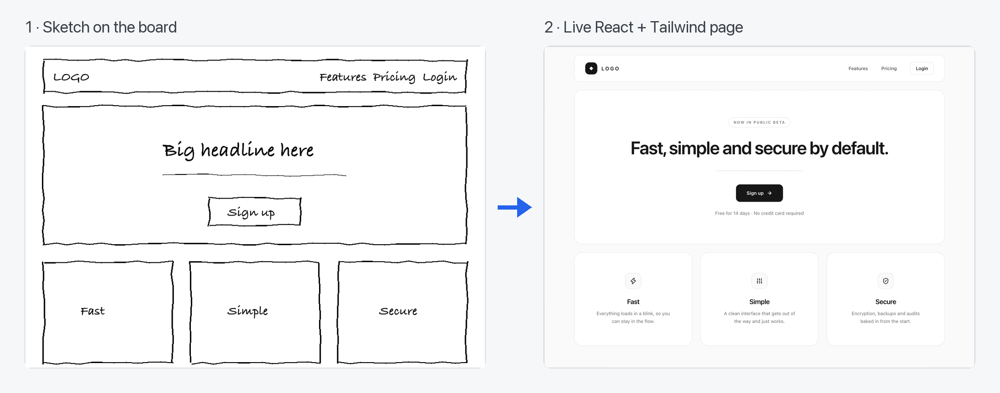
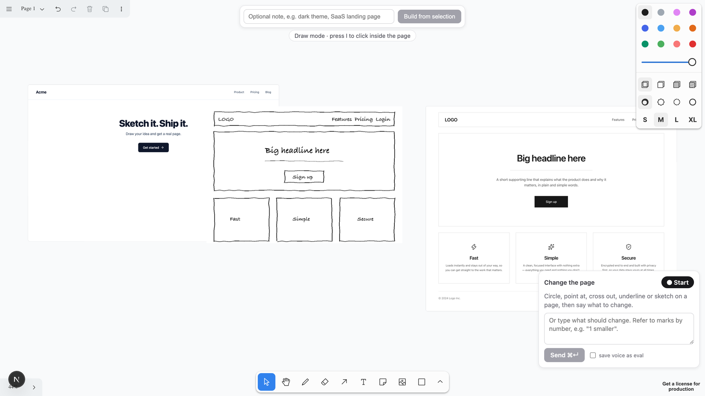
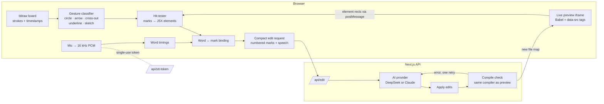

<div align="center">

# Draw.AI

**A whiteboard where your sketch becomes real UI.**

Draw a wireframe and get a working React page. Circle part of that page, say what should change, and the AI edits exactly the element you pointed at.




<sub>A real, unedited build: hand-drawn wireframe in, multi-file React + Tailwind page out, rendered live on the canvas.</sub>

</div>

---

## Why

Chat-based UI tools make you describe *where* in words: "the second button in the right-hand card". That's slow, and it's easy to get wrong.

Draw.AI is built on one idea: **pointing beats describing.** The pen says *where*, your voice says *what*.

- **Sketch new UI onto an existing page.** Draw a box between two sections and say "testimonials here". Click-to-edit tools can't do this, because there's nothing to click yet.
- **Give several instructions in one go.** Every mark gets a numbered badge (①②③), and the words you say while drawing it are bound to that mark.
- **Keep room to think.** Notes, references and earlier sketches live on the same infinite canvas as the page.



## What it does

| | |
|---|---|
| ✏️ **Sketch → page** | Select a wireframe or drop a screenshot, click **Build**, and a live page appears next to it as a multi-file React + Tailwind project. |
| 🎯 **Point → edit** | Circle, point at, cross out, underline or sketch on the live page. Each mark is resolved to the exact JSX element it covers. |
| 🎙️ **Talk while you draw** | Streaming speech-to-text with word timestamps. Words spoken while drawing a mark attach to *that* mark. |
| 🖱️ **Draw mode / interact mode** | Press `I` to click links and buttons inside the live page. Press it again to go back to drawing. |
| ↩️ **One-step undo** | The edit and the marks that caused it are one undo step, so ⌘Z brings both back. |
| 🔁 **Self-repairing output** | Every AI result is compiled on the server before you see it, and errors go back to the model for one fix round. |

## How it works



**The browser does the cheap, precise work** (geometry, hit-testing, binding words to marks, building the prompt). **The server holds the secrets and the AI calls.** The model only ever gets compact text plus the relevant files, and a small ink image only when a mark is ambiguous.

### Engineering highlights

**Exact element targeting with `data-src`.** The preview compiles TSX in the browser with `@babel/standalone` and a custom Babel plugin that stamps every JSX element with its source location (`data-src="components/Hero.tsx:18:4"`). The iframe reports each element's rectangle back to the board, so a circle on the canvas maps to a file, line and column. The model never writes these tags, so they're always correct, and they never reach exported code.

**Geometric gesture recognition, no AI involved.** Freehand strokes are grouped into marks by time and distance, then classified as circle, arrow, cross-out, underline or sketch using closure, straightness and direction-reversal tests. Hit-testing picks the right element for each gesture: ≥70% area containment for circles, the smallest meaningful element under an arrowhead, FROM→TO relations for arrows that start on one element and end on another, and a positional description ("between `<Hero>` and `<Pricing>`, ~300px tall") for new sketched regions.

**Speech bound to strokes on one clock.** Mic audio is captured with an AudioWorklet, resampled to 16 kHz PCM and streamed to ElevenLabs Scribe over a single-use token, so the API key never reaches the browser. Word timestamps are moved onto the same clock as the tldraw strokes, and each word binds to the mark drawn while it was spoken (±400 ms).

**Verify before render.** AI output is a set of targeted find-and-replace edits, not whole-file rewrites. The server applies them, then compiles the whole project with *the same compiler the preview uses* (no drift between check and render). Failures go back to the model once. Runtime errors in the iframe trigger one more automatic fix. Edits have a hard 45 s budget, and on failure the previous version is kept.

**Provider-agnostic AI layer.** The pipeline uses provider-neutral chat types, and each provider is a small adapter: DeepSeek (OpenAI-compatible API, the default for cost) and Anthropic Claude. Switching is one env var. Tall sketches are sent as top-to-bottom slices so detail survives the provider's image downscaling.

**Sandboxed, build-free preview.** Each generated page runs in a sandboxed iframe with React 19 from esm.sh and the Tailwind v4 browser build, so there's no bundler step between an edit and seeing it. Imports are restricted to `react` and `lucide-react`, enforced in both the prompt and the compiler.

## Performance

Measured end to end in the real app (click **Build** → page rendered in its iframe), headless Chromium, DeepSeek, Apple M3:

| Sketch | Typical build time |
|---|---|
| Login, landing page | **6–8 s** |
| Pricing, contact | ~11 s |
| Dashboard, blog (dense layouts) | 20–28 s |

Every measured build compiled and rendered on the first or repair attempt. Progress is shown the whole time.

## Tech stack

| Concern | Choice |
|---|---|
| App | Next.js 16 (App Router), React 19, TypeScript 5.9 |
| Canvas | tldraw 5, with a custom live-preview frame shape |
| In-browser compiler | `@babel/standalone` + a custom `data-src` JSX plugin |
| Preview styling | Tailwind CSS v4 browser build, ES modules from esm.sh |
| Speech-to-text | ElevenLabs Scribe v2 Realtime (streaming, word timestamps) |
| AI | DeepSeek (`deepseek-flash`) or Anthropic Claude, behind one interface |
| Tests | Vitest: 271 tests, including a geometric targeting eval, plus a live AI edit eval |

## Getting started

**Requirements:** Node.js ≥ 22.12 (see `.nvmrc`), and a DeepSeek or Anthropic API key. Voice also needs an ElevenLabs key with speech-to-text access.

```bash
git clone https://github.com/Bhanu1299/Draw-AI.git
cd Draw-AI
nvm use            # Node 22
npm install
cp .env.example .env.local   # then fill in your keys
npm run dev
```

Open http://localhost:3000.

```bash
# .env.local
AI_PROVIDER=deepseek          # or "anthropic"
DEEPSEEK_API_KEY=...
ANTHROPIC_API_KEY=...         # only when AI_PROVIDER=anthropic
ELEVENLABS_API_KEY=...        # optional: enables voice
```

### Try it

1. Draw a rough wireframe with the rectangle and text tools (or drop a screenshot), select it, and click **Build from selection**.
2. Circle something on the new page and type *"make this bigger"* in the panel, or press **● Start**, say it while you circle, then press **■ Stop**.
3. Draw a box in an empty spot on the page and say *"add three testimonial cards here"*.
4. Press `I` to click around inside the page. Press ⌘Z to undo any edit.

## Scripts

| Command | What it does |
|---|---|
| `npm run dev` | Start the app in development mode |
| `npm test` | Run the unit tests and the targeting eval |
| `npm run typecheck` | Type-check the whole project |
| `npm run build` | Production build |
| `npm run eval:edits` | Live AI edit eval against the real model (uses your API key) |

## Project structure

```
src/
├── app/                 Next.js routes: page + /api/build, /api/edit, /api/stt-token
├── board/               Board UI: build bar, instruction panel, voice button, interact mode, undo
├── frame/               Custom tldraw shape that hosts the live page, element registry
├── preview/             In-browser TSX compiler, data-src Babel plugin, sandboxed runtime
├── marks/               Stroke grouping, gesture classifier, hit-testing, word binding, evals
├── voice/               Mic capture, PCM resampling, Scribe streaming client, recorder
├── server/
│   ├── ai/              Provider-neutral chat layer + DeepSeek and Anthropic adapters
│   ├── build/           Sketch → project: prompt, file parsing, validation, repair round
│   ├── edit/            Edit prompt, edit-op parser, apply, verify, timeout
│   └── stt/             Single-use speech token minting
└── shared/              Types and geometry shared by client and server
```

## Testing and evals

- **Unit tests** cover every pure step: stroke grouping, gesture classification, hit-testing, word binding, the Babel plugin, import resolution, edit parsing and applying, prompt building, and the provider adapters.
- **Targeting eval** (`src/marks/evals/`) is a golden set of strokes on a known page with the elements each mark should resolve to. It runs without AI on every `npm test`.
- **Live edit eval** (`npm run eval:edits`) sends real instructions to the model and checks that the results compile and change the right code.
- The app can record real voice sessions as new eval cases ("save voice as eval"). A case only counts once it has been reviewed by hand.

## Roadmap

Draw.AI runs locally today. Next up:

- **Accounts and persistence:** Supabase auth, saved boards, version history, per-user daily limits and cost tracking
- **ZIP export** of the generated project
- **Start from a URL:** capture a public page and rebuild it as editable React + Tailwind
- **Variations side by side:** "3 versions of this hero" as live frames, then circle the winner
- **Live understanding:** badges and highlights that appear while you're still talking
- **Codebase mode:** the same draw-and-talk overlay on top of your own running localhost app, writing real edits to your repo

## Design docs

The product and architecture are documented in [`docs/superpowers/specs/2026-09-28-drawai-v1-design.md`](docs/superpowers/specs/2026-09-28-drawai-v1-design.md), including the gesture rules, hit-testing thresholds, prompt format, error handling and success criteria. Milestone implementation plans are in [`docs/superpowers/plans/`](docs/superpowers/plans/).

## License

[MIT](LICENSE) © 2026 Bhanu Teja

The canvas is built on [tldraw](https://tldraw.dev), which requires its own license for production use.
